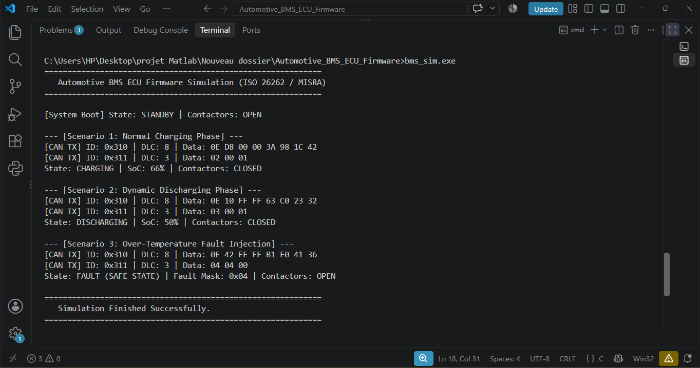

# Automotive BMS ECU Firmware (ISO 26262 / MISRA-C Compliant)

-blue.svg)


A safety-critical embedded firmware designed for an Electric Vehicle (EV) Battery Management System (BMS) Electronic Control Unit (ECU). The firmware enforces automotive functional safety paradigms (Safe State transitions, contactor control) and CAN 2.0B cyclic telemetry broadcast.

---

## 📷 Execution & Simulation Output

Below is the execution result validating normal operation, CAN message broadcasting, and instantaneous transition to the Safe State upon over-temperature fault injection:



---

## 🚀 Key Architectural Features

* **Finite State Machine (FSM):** Deterministic state transitions (`INIT`, `STANDBY`, `CHARGING`, `DISCHARGING`, `FAULT`).
* **Deterministic Periodic Scheduling:**
  * **10 ms Task:** Safety-critical fault detection (Over-voltage, Under-voltage, Over-temperature, Over-current) and immediate contactor isolation.
  * **100 ms Task:** CAN message packing and broadcasting.
* **ISO 26262 Functional Safety Concepts:** Instant contactor opening upon safety boundary violation (Fail-Safe State).
* **CAN 2.0B Communication:**
  * `0x310`: Battery Pack Telemetry (Voltage, Current, Temperature, SoC).
  * `0x311`: ECU Operating State, Contactor Status, Active Fault Masks.
* **MISRA-C Alignment:** Fixed-width integer types (`stdint.h`), explicit bit-mask operations, zero dynamic memory allocation.

---

## 📁 Repository Structure

```text
├── bms_config.h         # Safety thresholds, timing periods, and CAN IDs
├── bms_core.h           # Data structures, FSM enumerations, and function prototypes
├── bms_core.c           # Core FSM logic, SoC approximation, and periodic tasks
├── can_driver_mock.h    # CAN hardware abstraction layer (HAL) interface
├── can_driver_mock.c    # Virtual loopback CAN bus transceiver mock
├── main.c               # Test harness and scenario runner (Normal + Fault injection)
└── bms_simulation_output.png # Simulation execution capture